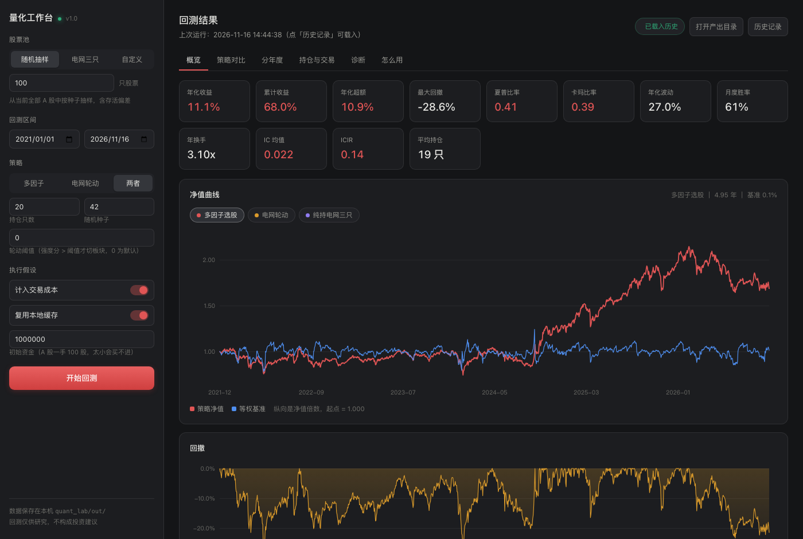

# 量化实验台 · 从零到实盘的方案

一个最小可用的多因子回测框架，以及一份诚实的路线图。
目标不是"做出一个赚钱的策略"，而是**建立一个能证伪自己的系统**——因为不能证伪的东西，你没法判断它是否失效。

> **零终端用法**：双击 **`量化工作台.app`**，浏览器会自动打开图形界面（参数、进度、净值曲线、持仓、诊断全在里面）。
> 不用敲任何命令。首次打开如被系统拦截，右键 → 打开 即可。
>
> 
>
> 截图是较早的版本：新版在「选股排名」后面多了 **压力测试** 页，诊断页第一张表是 **数据来源与新鲜度**。

> **想核对数字**：[`docs/实测记录.md`](docs/实测记录.md) 记了每个数字的来源、口径、复现命令，
> 也记了记过的错；[`results/`](results/) 放着对应的原始产物（净值、成交、持仓、排名、压力测试），
> 可以直接打开 CSV 对。

---

## 一、先认清：量化分五级，你只需要到第 2 级

| 级别 | 内容 | 工作量 | 适合谁 |
|---|---|---|---|
| **L0 规则化** | 把买卖条件写成一页纸，机械执行 | 1 天 | 所有人。**这一步收益最大、成本最低** |
| **L1 打分表** | 多因子加权排序，月度调仓，Excel 也能做 | 1 周 | 个人投资者 |
| **L2 回测** | 代码化验证：成本、涨跌停、样本外 | 3–4 周 | **本仓库覆盖的层级** |
| **L3 组合优化** | 风险模型、行业中性、协方差估计 | 3–6 月 | 有编程基础 + 50 万以上 |
| **L4 实盘工程** | 数据管道、下单接口、监控、归因 | 6 月+ | 机构 / 半职业 |

**大多数个人投资者失败的原因不止是策略太差，更常见的是基础设施没建好**：数据有存活偏差、回测有未来函数、实盘没算成本。所以本仓库刻意把 L2 做扎实，L3/L4 留接口但不实现。

---

## 二、这个仓库里有什么

```
quant_lab/
├── 量化工作台.app       双击启动的图形界面（无终端）
├── 启动量化工作台.command 备用启动方式（会开终端窗口）
├── app/
│   ├── server.py       本地服务：任务队列 + 进度 + 导出（纯标准库）
│   └── static/         前端：单页界面 + 自绘图表（无 CDN）
├── run.py              合成数据自检 / 接本地 CSV
├── run_real.py         真实 A 股：抓数 → 多因子 → 电网轮动 → 偏差测算
├── requirements.txt
├── docs/
│   ├── USAGE.md        使用说明：每个指标怎么读、报错对照表
│   ├── TOOLS.md        工具盘点：数据源/框架/实盘/存储
│   └── 实测记录.md      每一个数字的来源、口径、复现命令，以及记过的错
├── results/            实测产物归档（净值/成交/持仓/排名/压力测试，可对着核对）
├── tools/
│   └── collect_results.py  把 out/jobs/<id>/ 整理成 results/ 归档
├── src/
│   ├── data.py         合成数据（内置已知有效因子）+ CSV 读取
│   ├── realdata.py     akshare 多源抓取 + 缓存 + 退市统计
│   ├── fundamentals.py ROE / 净利同比，按披露截止日对齐（质量、成长因子）
│   ├── tushare_source.py 可选：tushare 适配器（含退市全样本 + 真实公告日）
│   ├── factors.py      价值/质量/成长/动量，排名百分位打分
│   ├── sector.py       行业轮动因子（RS20/RS60 强度分）
│   ├── engine.py       月度调仓、T+1 开盘、涨跌停拦截、双边成本
│   └── report.py       HTML 报告生成
├── data/               prices.csv / fundamentals.csv / cache
└── out/                回测报告与 summary_real.json
```

### 跑起来

**方式一：图形界面（推荐，不需要终端）**

双击 `量化工作台.app` → 浏览器打开 `http://127.0.0.1:8770/` → 左侧设参数 → 点「开始回测」。

界面里能做的事：切股票池（随机抽样 / 电网三只 / 自定义代码）、改区间与持仓数、开关交易成本、
看实时进度与日志、看净值与回撤、三条策略叠加对比、分年度收益、期末持仓、**选股排名**（含名称与行业）、
**抽样压力测试**、数据来源与新鲜度、信号与诊断、下载 CSV（含 ranking.csv / stress.csv）、
打开完整 HTML 报告、回看历史记录。

**选股排名**页会列出最近一期全部股票的总分与四个因子百分位、名次、以及状态
（持有 / 新进 / 已跌出前 N / 未入选），能直接回答「为什么是这 20 只」。

**方式二：命令行**

```bash
pip install -r requirements.txt
python3 run.py --demo                 # ① 合成数据自检
python3 run_real.py --n 100           # ② 真实 A 股 100 只
python3 run_real.py --mode rotation   # ③ 只看电网设备轮动
```

详细说明见 **[docs/USAGE.md](docs/USAGE.md)**，工具选型见 **[docs/TOOLS.md](docs/TOOLS.md)**。

### 数据契约（任何来源都能接）

`data/prices.csv`（宽表转长表即可，字段必须齐）：

| date | code | open | close | limit_up | limit_down | suspended | volume |
|---|---|---|---|---|---|---|---|
| 2026-01-05 | 600312 | 21.8 | 22.0 | 24.2 | 19.8 | false | 8123400 |

`data/fundamentals.csv`（按**公告日**对齐，不是报告期）：

| date | code | pe_ttm | pb | roe_ttm | net_profit_yoy |
|---|---|---|---|---|---|
| 2026-04-28 | 600312 | 21.8 | 2.1 | 11.2 | 25.3 |

> `date` 必须是**这份数据真实可得的日期**。用报告期末（如 2026-03-31）会引入 1–2 个月的未来信息，这是散户回测最常见的致命错误。

---

## 三、数据从哪来、是不是最新的

四个免费接口，本地抓取、本地计算，不上传任何东西。界面「诊断」页第一张表就是这张的实时版：

| 类型 | 接口（akshare） | 口径 | 最新到 |
|---|---|---|---|
| 行情 | `stock_zh_a_hist_tx` 腾讯财经 | 日线 · 前复权 | 最近一个交易日 |
| 估值 | `stock_zh_valuation_baidu` 百度股市通 | 每日 PE(TTM) | 同上，按交易日对齐 |
| 财报 | `stock_yjbb_em` 东方财富业绩报表 | 季度，含 ROE / 净利同比 / 行业 | 法定披露截止日 |
| 退市 | `stock_info_sh_delist` / `_sz_delist` | 暂停终止上市名单 | 只用于估偏差，不进样本 |

**「是不是最新」分三层，别混为一谈：**

1. **源端延迟（改不了）**。腾讯的日线要等收盘后 1–2 小时才发当日 K 线。实测 2026-11-16 16:00 抓取，
   最后一根还是 11-13——这不是缓存，是刚重新请求的结果。想要「今天收盘价」得等晚上。
2. **本地缓存（能改）**。默认勾选「复用本地缓存」，重跑不再请求，所以**看到的数据可能是上次抓的**。
   要绝对值最新的数据，把开关关掉再跑一次。
3. **财报的会计延迟（故意保留）**。财报按**法定披露截止日**（Q1 4/30、H1 8/31、Q3 10/31、年报次年 4/30）
   才允许进入打分，而不是报告期末，也不是「表里最新公告日」。
   为什么不用最新公告日：那是**含更正公告**的最新日期，实测 2023 年中报有标的被标到 2026 年，
   用它对齐会让历史因子永远缺席。宁可晚用，不可早用。

> 想验证数据是否新鲜：界面「诊断」页第一张表会显示每类数据的最新日期；
> 关掉缓存重跑，如果日期没变，说明确实是源端没更新，不是本地旧了。

### 接 tushare（可选，用来治存活偏差和真实公告日）

免费源拿不到两样东西：**已退市的股票**、**真实公告日**。`src/tushare_source.py` 把这条路留好了，
结构与免费源完全一致（同一个 panel、同一个引擎），配 token 就能换过来：

```bash
pip install tushare
export TUSHARE_TOKEN=你的token          # https://tushare.pro 注册后复制

python3 -m src.tushare_source --check   # 自检：连通性 + 字段是否齐
python3 -m src.tushare_source --delisted out/delisted.csv   # 导出区间内退市股
```

代码里换源：

```python
from src import tushare_source as ts
panel = ts.panel(codes, "20210101", "20261116")   # 行情 + 财报，接口同 realdata
```

三个和免费源不同、值得注意的点：

- **退市全样本**：`ts.universe(include_delisted=True)` 能拿到 `list_status='D'` 的代码，
  这才是消除存活偏差的正解（免费源只能"估算偏差有多大"，不能"消除"）。
- **真实公告日**：tushare 的 `fina_indicator` 有 `ann_date`，不必再用法定截止日近似。
  但注意它是**首次公告日**，日后被更正的话仍算轻微前视——严格 PIT 需要存每日快照。
- **限频**：免费额度约 120 次/分钟，超了会**静默返回空**而不是报错，
  所以适配器里自带节流（110 次/分钟）。抓 100 只要一分多钟。

---

## 四、真实 A 股结果（2026-11-16 实测）

```
多因子（100 只抽样 = 97 只随机 + 电网 3 只、可交易 59 只、持仓 20 只，2021-01 → 2026-11）
  年化 7.12% ｜ 基准 0.14% ｜ 超额 6.98%
  波动 —      ｜ 回撤 -32.9% ｜ 夏普 0.26
  IC 0.010    ｜ 年换手 —     ｜ 生效因子：价值 + 质量 + 成长 + 动量

电网设备轮动（平高/思源/特变）
  rotation     年化 13.94% ｜ 回撤 -35.3% ｜ 夏普 0.48
  sector_only  年化 16.44% ｜ 回撤 -41.4% ｜ 夏普 0.50
  当前信号：强度分 -0.20 → 回到全市场

存活偏差测算
  样本 100 只全部活到今天；其中 36 只是 2021 年后才上市
  区间暂停/终止上市 228 只 / 现存 5579 只 → 退出率 3.93%
  估算等权基准年化虚高 0.57 个百分点
```

### 一个必须说清楚的对比：这一刀到底砍在哪

同一批股票、同一个种子，**只切换「有没有财报因子」**，得到一张 2×2。
（`fundamentals=false` 即回退到只用价值+动量，界面「执行假设」里有开关，两组都能自己复现。）

| 模式 | 股票池 | 只有价值+动量 | 四因子齐全 | 差异 |
|---|---|---|---|---|
| both（多因子+轮动） | 97 只随机 + 电网 3 只 = 100，可交易 59 | **11.06%** ／ -28.6% ／ IC 0.022 | **7.12%** ／ -32.9% ／ IC 0.010 | −3.94pp |
| factor（只跑多因子） | 100 只随机，可交易 69 | **4.37%** ／ -36.1% ／ IC 0.008 | **4.08%** ／ -36.7% ／ IC -0.002 | −0.29pp |

读这张表要拿掉一个之前犯的错：

1. **补财报因子本身几乎不改变收益。** factor 模式同池对照只差 0.29pp，落在噪声里。
   早先"11.06% → 4.08%，补齐因子反而亏 7pp"的说法是**口径错误**——
   那两个数来自两个不同的股票池（97+3  vs  纯 100 随机），差值不是因子造成的。
2. **股票池成分比因子选择重要得多。** 同样只有价值+动量，97 只随机+电网 3 只是 11.06%，
   纯 100 只随机是 4.37%，相差 6.7 个百分点。**三只股票就能决定四年的年化。**

第 2 条才是这个项目真正想说的：在 100 只这种样本量上，
你测到的主要是「抽到了谁」，不是「方法好不好」。第五节的压力测试就是用来量这件事的。

**这几组数字的正确读法：**

- **IC 0.010 基本等于噪声。** 100 只样本的 IC 标准误约 `1/√100 = 0.10`，0.010 完全落在随机区间。
- **轮动 13.94% 不能信。** 3 只股票、约 60 个月、1 个阈值，做不了显著性检验。夏普 0.48 不等于策略有效，等于样本太小。
- **唯一可信的是 0.57pp/年 的存活偏差**，方向明确、量级可复现。

这正是免费数据的价值：**它能告诉你"哪里会骗你"，但不能告诉你"什么能赚钱"。**

---

## 五、抽样压力测试：单次回测的数字有多少是运气

界面左侧「抽样压力测试」按钮做的事：**不调参数、不改因子，只换一批股票**，
从 400 只母体里反复抽 100 只、跑 12 次，看年化的分布。

```
母体 400 只 · 每次抽 100 只、持仓 20 只 · 12 次（2021-01 → 2026-11）
  年化：中位 +1.85% ｜ 中间 80% 区间 -1.29% ~ +9.00% ｜ 最差 -2.74% ｜ 最好 +10.74%
  超额：中位 +1.62% ｜ 12 次里 8 次跑赢等权基准（67%）
  回撤：中位 -34.7% ｜ 最差 -42.2%
  IC 中位 -0.009
  年化标准差 4.2 个百分点
```

**这组数字把上面的 7.12% 打回了原形。**

单次回测告诉你"这套规则年化 7.12%、超额 6.98%"。压力测试告诉你：同一套规则，
换 100 只股票，年化能从 **-2.7% 跑到 +10.7%**，中位数只有 **+1.85%**，超额中位数 **+1.6%**。
也就是说——**7.12% 那次是运气偏上的那一次，规则本身的水平大约是 +1.6%/年，还得扛 -35% 的回撤。**

怎么读：

- **中间 80% 的区间**才是这套策略真实的能力范围。区间跨 10 个百分点以上，就别拿中位数当预期收益。
- **「跑赢基准占比」**67% 看起来不错，但配上 1.6% 的超额中位数就露馅了：跑赢的幅度很小，
  跑输的那 4 次却可能很深。这是典型的"胜率高、赔率低"，扣掉成本后基本归零。
- **这是下界**：母体只有 400 只，真实全 A 股（5000+）的抽样波动一定更宽。
- 最诚实的结论：**这套四因子规则在 100 只样本上不成立**。它有信息量（IC 方向对得上），
  但强度远远不够覆盖它的回撤。要往 300 只以上、加上行业/市值中性再谈。

---

## 六、自检结果（合成数据）

合成数据里埋了一个**已知有效**的价值因子（±1σ 年化约 30% 的收益差）。
如果引擎抓不到它，说明代码有 bug；抓到了，才说明代码可信。

```
年化收益 8.63% ｜ 基准 1.36% ｜ 年化超额 7.26%
年化波动 16.2% ｜ 夏普 0.53 ｜ 最大回撤 -32.1%
月度胜率 59.5% ｜ 年换手 5.55 倍
IC 均值 0.126 ｜ ICIR 1.54

分年度：2021 -16.7% ｜ 2022 +0.9% ｜ 2023 +25.6% ｜ 2024 +20.5% ｜ 2025 +5.2%
```

**注意 2021–2022 连续两年跑输基准。** 这不是 bug，是真实策略的常态：
**任何多因子策略都会有连续 1–2 年跑输的时期**，如果你不能接受这一点，就不适合做量化。

---

## 七、五个必踩的坑（按杀伤力排序）

1. **存活偏差（最致命）**
   akshare / 通达信免费数据只含**当前存续**的股票，已退市、被并购的拿不到。
   结果：回测里你永远买不到那 300 只归零的股票，年化虚高 3–8 个百分点。
   **解法**：付费数据（Wind / 聚源 / 米筐 / 聚宽），或 tushare 的 `list_status='D'` 全样本
   （本仓库 `src/tushare_source.py` 已接好），或用指数成分股历史名单反推。

2. **未来函数**
   用报告期代替公告日、用当日收盘价成交、用"最新"财务数据回填历史。
   本仓库的对应防护：`fundamentals.date` 必须 ≤ 调仓日；一律**次日开盘**成交。

3. **复权口径混用**
   算因子用前复权（qfq），算涨跌停用**不复权**。混用会让涨跌停判断全部失效。
   本仓库的 `limit_up/limit_down` 需要你按不复权价另外算好喂进来。

4. **涨跌停与停牌**
   涨停买不进、跌停卖不掉。忽略它们，回测会把"事后看最牛的股票"全部买进去。
   本仓库：`open >= limit_up` 拒绝买入，`open <= limit_down` 拒绝卖出，停牌跳过。

5. **成本**
   A股：佣金万 2.5（最低 5 元）+ 印花税千 0.5（仅卖出）+ 滑点。
   月度调仓 20 只、年换手 5 倍，成本约吃掉 **0.6–1.0 个百分点/年**。
   本仓库默认 `commission=0.00025, stamp=0.0005, slippage=0.001`，可直接改。

---

## 八、因子从哪来

不要自己发明因子。先从公开的、有几十年样本外证据的因子开始：

| 类别 | 因子 | 经济学解释 | A股有效性 |
|---|---|---|---|
| 价值 | EP、BP、股息率 | 便宜的东西长期跑赢 | 强，但 2019–2021 长期失效 |
| 质量 | ROE、毛利率稳定性、应计 | 好公司持续好 | 中强，2021 后显著增强 |
| 成长 | 营收/净利增速、超预期 | 预期上修有惯性 | 中，波动大 |
| 动量 | 20/60/120 日收益 | 趋势延续 | **A股偏弱、反转更强**，需谨慎 |
| 低波 | 波动率、beta | 低风险异象 | 强，但牛市跑输 |
| 情绪 | 换手率、龙虎榜 | 拥挤度 | 短期有效，衰减快 |

**本仓库默认权重**：价值 30% / 质量 25% / 成长 25% / 动量 20%。
改权重请改 `factors.DEFAULT_WEIGHTS`，然后**看样本外**，不要看样本内最优。

---

## 九、怎么判断一个策略是真的

四个数字，缺一不可：

1. **IC 均值 > 0.03，ICIR > 0.5** — 因子和未来收益的相关性。IC 0.05 已属优秀。
2. **年化超额 > 5%，且分年度至少 70% 的年份为正** — 只看总收益会被某一年掩盖。
3. **最大回撤 < 基准回撤 × 1.5** — 超额如果是靠加杠杆/加集中度换来的，不算本事。
4. **换手对应的成本后仍为正** — 换手 20 倍的策略，成本能吃掉全部超额。

**再加一条最重要的：样本外。**
把数据前 70% 做设计、后 30% 只跑一次。如果你在样本外反复调整参数，它就已经不是样本外了。

---

## 十、从回测到实盘的差距清单

回测跑通 ≠ 能赚钱。上实盘前逐条打勾：

- [ ] 数据每日自动更新，含停牌、除权、ST 变更
- [ ] 用**模拟盘**跑满 3 个月，对比回测与模拟的滑点差异
- [ ] 单票上限、行业上限写进代码（不是记在脑子里）
- [ ] 有明确的**停止条件**：回撤超过 X% 或 IC 连续 N 月为负，自动降仓
- [ ] 交易日志：每笔记录信号值、成交价、滑点，事后能归因
- [ ] 心理准备：连续 6 个月跑输时，你还能执行规则吗

---

## 十一、90 天计划

| 周 | 做什么 | 交付物 |
|---|---|---|
| 1 | 跑通本仓库 `--demo`，读懂 `engine.py` 每一行 | 能解释为什么用次日开盘 |
| 2 | 接真实数据（先 100 只股票即可） | `data/*.csv` |
| 3 | 单因子测试：价值、质量、动量分别跑一遍 | 三张 IC 曲线 |
| 4 | 组合因子，调权重，**只用前 70% 数据** | 一个候选策略 |
| 5 | 样本外验证（后 30%），记录第一版结果 | 样本外报告 |
| 6 | 敏感性测试：改 top_n、改调仓频率、改成本 | 稳健性表 |
| 7–8 | 模拟盘 | 模拟 vs 回测的偏差 |
| 9–12 | 小资金实盘（不超过总仓位 10%） | 真实滑点与心理记录 |

---

## 十二、一句提醒

**量化并不保证赚钱，它真正提供的是可解释的输赢。**
一个策略亏钱时，你能知道是因子失效、成本太高、还是市场风格切换——这个能力，比任何一次盈利都值钱。

反过来说：如果你做完这套流程，发现自己的策略年化超额只有 3%、还扛不住 30% 的回撤，
那**最理性的结论可能是"不做了，买宽基"**。这也是一个合格的结果。

---

*本仓库仅用于研究与教学，不构成投资建议。回测收益不代表未来表现。*
